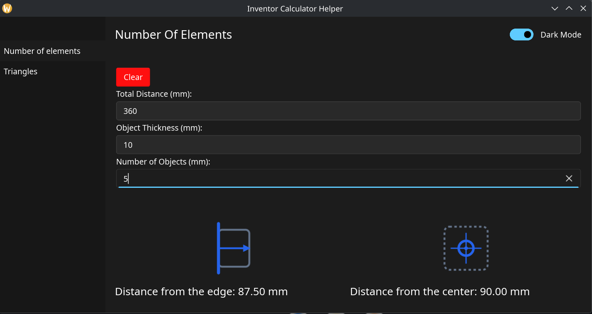
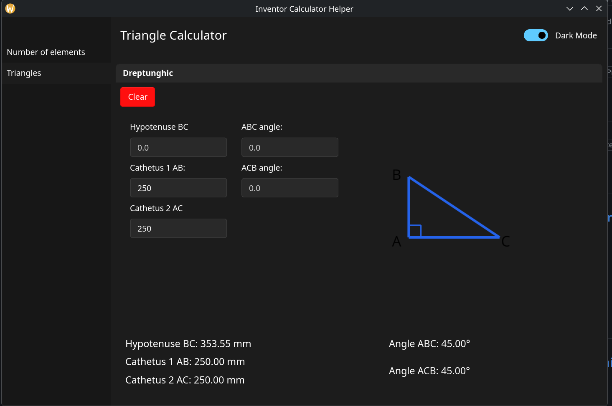

# 3D CAD Helper

This is an app created to ease the work with any 3D CAD software.

## Number of elements

Here is an example of usage. If the used constraint is an edge or the center of a circle.

## Right Angle Triangle

An example of Right Angle Triangle calculator of hypotenuse and catheters and Angles.

# ToDo

1. Calculator to convert kg (and kg/sqm ) to N and to MPa to use it in simulations.