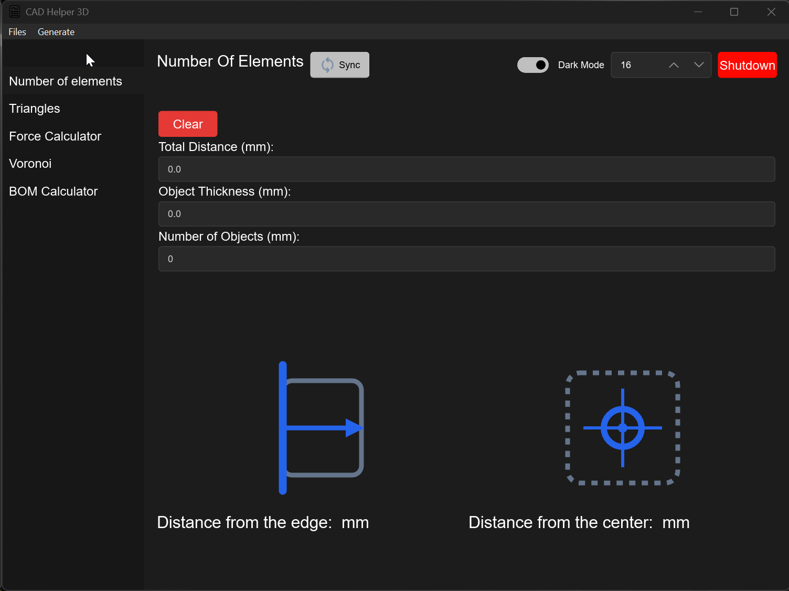
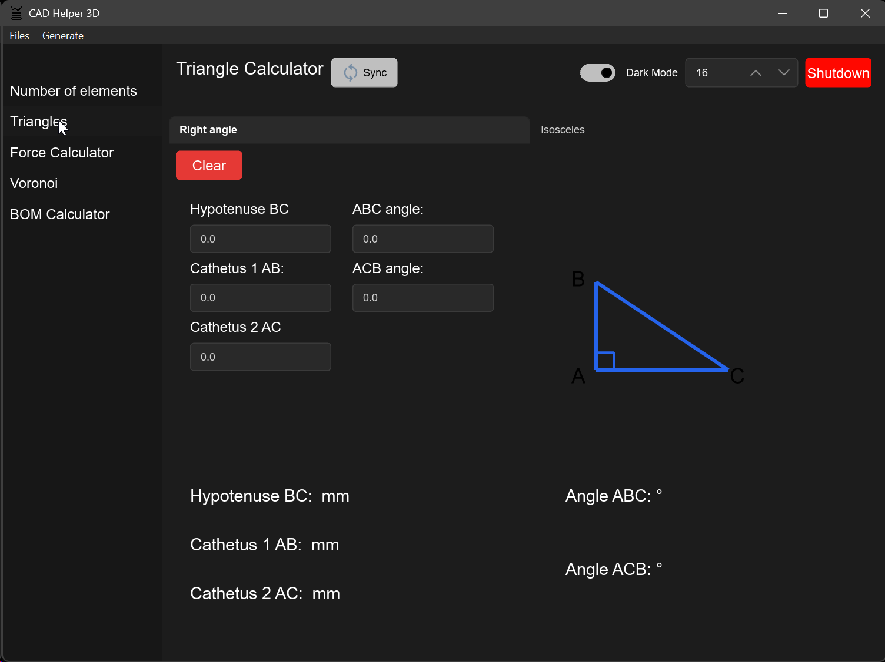
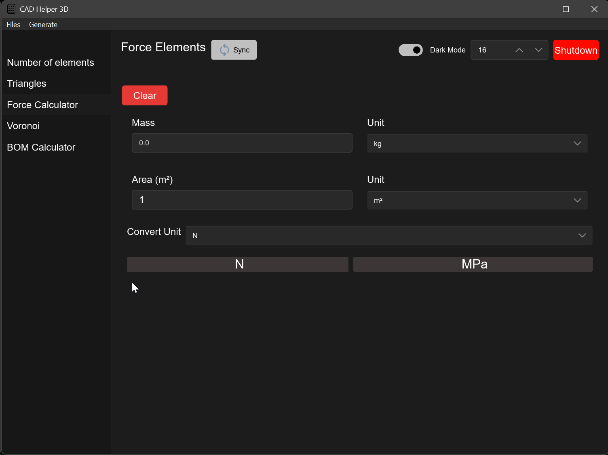
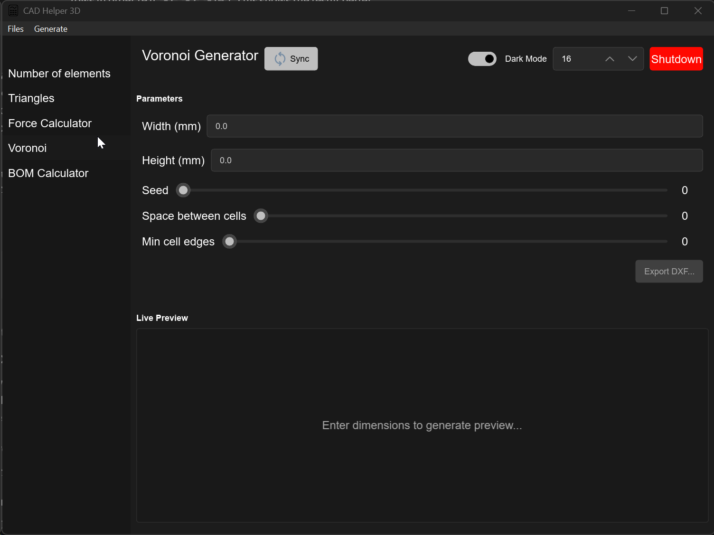
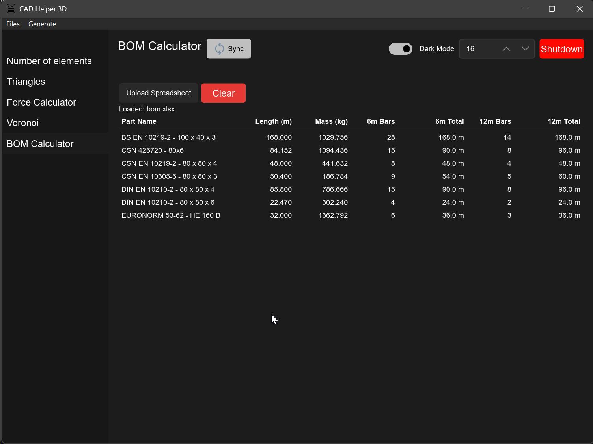

# 3D CAD Helper

A lightweight desktop toolbox for CAD and fabrication work. It handles the small calculations and file chores that come up while designing: spacing parts, solving triangles, sizing forces, generating cut patterns, totalling stock from a BOM and starting a parts list for a drawing set.

Built in **Rust** with the **Slint** UI toolkit.

---

## Contents

| Tool | What it does | Input → Output |
|---|---|---|
| [Number of Elements](#number-of-elements) | Spacing and count of elements along a length or around a circle | Dimensions → spacing |
| [Triangle Solver](#triangle-solver) | Sides and angles of right-angle and isosceles triangles | Known values → missing values |
| [Force & Pressure Calculator](#force--pressure-calculator) | Force, pressure and area calculations with unit conversions | Values → result |
| [Voronoi Generator](#voronoi-generator) | Voronoi cut patterns for plates and panels | Parameters → `.dxf` |
| [BOM Calculator](#bom-calculator) | Total profile length, mass and stock bars from a Fusion 360 BOM | `.csv` / `.xls` / `.xlsx` / `.xlsm` → summary |
| [Parts List Export](#parts-list-export) | Excel parts list from a project's drawings | `Draw` folder → `.xlsx` |
| [Scheduled Shutdown](#scheduled-shutdown) | Turns the PC off after a delay | Delay → shutdown |

---

## 🚀 Getting Started

### Install

Download the latest Windows installer from the [Releases](../../releases) page and run it. To run on another OS, [build from source](#-building-from-source).

### Finding your way around

- The **sidebar** switches between tools. Each tool keeps its values while you move between pages.
- The **page header** is shared by every tool and holds the [Scheduled Shutdown](#scheduled-shutdown) control.

---

## 📐 Tools

### Number of Elements

Works out how many elements fit along a length, or around a circle, and how far apart they are. The spacing can be measured from the edges or from the centre of a circle. Use it for hole patterns, bolt circles, fins, slats and similar repeated features.



### Triangle Solver

Enter the values you know and the solver fills in the rest. It has two tabs:

- **Right-angle:** hypotenuse, the two legs and the angles.
- **Isosceles:** base, equal sides, height and angles.

Handy for chamfers, gussets, bends and slopes without leaving your CAD workflow.



### Force & Pressure Calculator

Solves for force, pressure or area from the other two values, with unit conversions built in.



### Voronoi Generator

Generates a Voronoi pattern for decorative or lightening cut-outs.

1. Set the pattern parameters and check the preview.
2. Click **Export DXF** and choose where to save it.

The file is a plain **DXF R12 (ASCII)**. It opens in Inventor, Fusion 360, AutoCAD and most laser/plasma CAM software.



### BOM Calculator

Turns a Fusion 360 BOM export into a material summary for ordering stock.

1. In Fusion 360, export the BOM as `.csv`, `.xls`, `.xlsx` or `.xlsm`.
2. Open the file in the BOM Calculator.

Rows for the same profile are merged by dropping the trailing `-<length>` from the part number, so `RHS40x40x3-1250` and `RHS40x40x3-800` count as one profile, `RHS40x40x3`.

For each profile you get:

- total length
- total mass
- number of **6 m** and **12 m** bars needed

> The bar count is total length ÷ bar length, rounded up. It doesn't plan individual cuts or allow for saw kerf, so leave yourself some margin.


### Parts List Export

Starts the parts list (*lista de repere*) for a project from its drawings.

It expects the usual project layout:

```
VDN271001\
└── Draw\
    ├── VDN271001-1.pdf
    ├── VDN271001-2.pdf
    ├── VDN271001-2.dxf
    ├── VDN271001-10.pdf
    └── ...
```

1. Click the export button and pick the project's **`Draw`** folder.
2. The app writes **`VDN271001.xlsx`** into that `Draw` folder. Both the workbook and its sheet take the project folder's name.

The sheet has these columns:

| Nr.Crt. | Reper | Grosime | Material | Cantitate | Observatii |
|---|---|---|---|---|---|
| 1 | VDN271001-1 | | | | |
| 2 | VDN271001-2 | | | | |
| 3 | VDN271001-10 | | | | |

- **Nr.Crt.** and **Reper** are filled in for you. The other columns are left empty to complete by hand.
- Drawings are listed in natural order, so `-2` comes before `-10`.
- Only drawing files count: `.pdf`, `.dxf`, `.dwg` and `.idw`. A part saved in several formats gets a single row.
- Everything is 16 pt and the columns are sized to fit, so the sheet is easy to read straight away.

> An existing workbook with the same name is **overwritten**. Close it in Excel before exporting, or the save will fail.



### Scheduled Shutdown

Turns the computer off after a delay. It's useful when you leave a long render, FEA run or export going at the end of the day.

- Start it from the header of any page.
- The countdown keeps running while you switch tools.
- It also survives closing and reopening the app.
- Cancel it at any time from the same place.

The deadline is stored in `%LOCALAPPDATA%\cad-helper-3d\shutdown.txt`.

> **Windows only** for now.

---

## 🛠️ Building from Source

### Prerequisites

* [Rust & Cargo](https://rustup.rs/)
* [cargo-make](https://github.com/sagiegurari/cargo-make), installed with `cargo install cargo-make`

### Run locally

```shell
cargo run --release
```

### Release builds

The build tasks are defined in [Makefile.toml](Makefile.toml). To list them all:

```shell
cargo make --list-all-steps
```

To compile, package and prepare a release for your current operating system:

```shell
cargo make release-all
```

On every release, **GitHub Actions** builds the Windows installer with Inno Setup, using [`build_assets/installer.iss`](build_assets/installer.iss).

---

## 🗂️ Project Structure

Each tool lives in its own module folder under `src/`:

```
src/<tool>/
├── mod.rs        # re-exports
├── <tool>.rs     # logic, no UI code
└── ui.rs         # Slint callbacks and wiring
```

`batch_printing` is the reference module for how callbacks, file dialogs and error reporting are wired up. New tools follow the same pattern.

---

Release history is in [CHANGELOG.md](CHANGELOG.md).